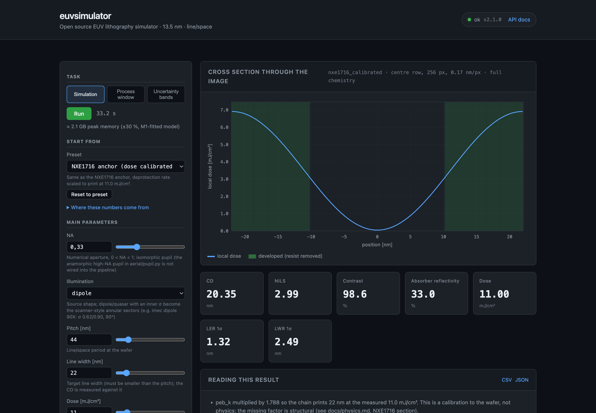
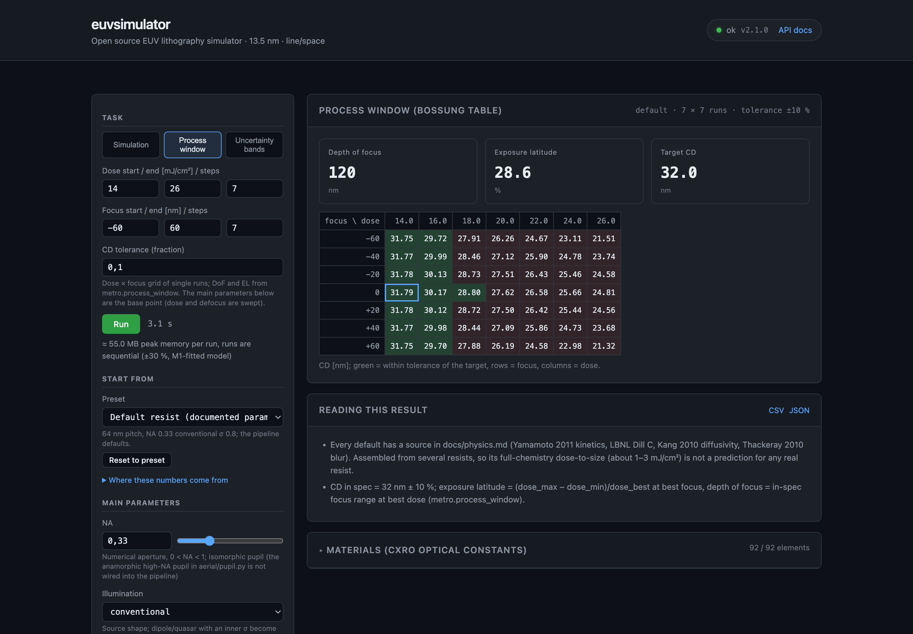

# euvsimulator

**An open-source EUV lithography simulator whose every physical default has a named source.**

[](https://github.com/Flowbudget/euvsimulator/actions/workflows/ci.yml)
[](https://github.com/Flowbudget/euvsimulator/releases)
[](pyproject.toml)
[](LICENSE)

euvsimulator models the EUV imaging and resist chain at 13.5 nm — multilayer mirror, mask
diffraction, partially coherent imaging, chemically amplified resist, development, and the
stochastics behind line-edge roughness — in Python and PyTorch, on a laptop.

What sets it apart is not the number of modules but the bookkeeping: each default of the resist
chain is either measured in a cited paper, derived from a cited measurement, or explicitly
labelled as a calibration or an assumption. Two named resists serve as anchors, and the distance
between simulation and measurement is documented rather than tuned away.
See [docs/physics.md](docs/physics.md) for the chain, the sources and the open questions.

## What it is — and what it is not

- **It is** a transparent, tested physics chain for studying how exposure, bake, development and
  noise interact, with the provenance of every number one click away.
- **It is not** a predictive tool for production resists. At the NXE1716 anchor the printing dose
  comes out 1.7× above the measurement (18.7 against 11.0 mJ/cm², re-measured after the 2026-10
  fixes; an inconsistency inside the source data), and the
  simulated LWR of 4.8–13 nm 3σ, depending on a blur nobody has measured for that resist,
  brackets the measurement: 0.72×–1.94× of the SEM-biased 6.7 nm, or 0.84×–2.5× of the
  bias-corrected 5.1–5.7 nm; at the MET-2D anchor the simulated roughness is 4.3 nm 3σ against
  6.7 nm measured with SEM bias (both roughness results measured before the 2026-10 fixes, not
  re-measured).
  Two physics questions that no freely available measurement decides change results by a factor
  of two; `euv calibrate --bands` reports them as bands.

## Quick start

```bash
pip install git+https://github.com/Flowbudget/euvsimulator.git
```

```bash
euv simulate --period 64 --cd 32 --dose 1.3 --resist-model full_chem   # default resist
# Bossung, DoF, EL: 1 mJ/cm² steps around the dose-to-size (about 13 mJ/cm²)
euv process-window --period 64 --cd 32 --dose-start 10 --dose-end 19 --dose-steps 10 --focus-start -150 --focus-end 150
euv calibrate wafer.csv --period 44 --cd 22 --bands                      # fit your own FEM
euv serve                                                                # browser GUI + REST API
```

```python
from euvsimulator.pipeline import SimulationConfig, run_simulation

cfg = SimulationConfig(period_nm=64, line_width_nm=32, dose_mj_cm2=1.3, resist_model="full_chem")
result = run_simulation(cfg)
print(f"CD {result.cd_nm:.1f} nm, NILS {result.nils_value:.2f}")
```

The default resist is a 2011 research resist (Yamamoto et al.) and prints at about
1.25 mJ/cm² at 64 nm pitch — far more sensitive than a production resist. Use the presets in
`euvsimulator.presets` (NXE1716, MET-2D) or calibrate to your own data.

## Browser GUI

`euv serve` starts a local server with a single-page GUI at `http://localhost:8000/` and the
REST API (`/docs`). No external assets, works offline.



- **Presets with provenance** — the documented default resist, the NXE1716 anchor as a
  prediction (dose-to-size 18.7 vs measured 11.0 mJ/cm²), the same anchor with the ×1.66
  dose calibration labelled as such, and the MET-2D anchor. "Where these numbers come from"
  is one click away, and every result carries its notes.
- **Every parameter** — six main ones open, the other 58 `SimulationConfig` fields in
  collapsed groups with the same help texts as the CLI. Physical limits only (NA < 1,
  CD < pitch, …); grid, rows, seeds and realisations are unbounded, a live estimate says
  what a run will need in memory (model fitted on the reference machine, ±30 %).
- **Three tasks** — a single simulation (profile, CD, NILS, LER/LWR with n_eff and
  correlation length), a process window (Bossung table, depth of focus, exposure latitude)
  and the structural uncertainty bands of `euv calibrate --bands`. Runs are background jobs
  with progress and a cancel button; results export as CSV and JSON.
- **Links reproduce runs** — `?preset=met2d&task=process_window&f.grid=128&run=1` starts a
  run on load, `?job=<id>` reopens a finished one.



## What is inside

| Stage | Model | Notes |
|---|---|---|
| Materials | CXRO atomic scattering factors, Z = 1–92 | absorption of a resist computed from its composition |
| Multilayer mirror | S-matrix transfer-matrix method, Névot–Croce roughness | verified against Fresnel and energy-conservation limits |
| Mask | thin-mask Fourier series; RCWA 1D optional, 2D as scalar module | no flare, no mask roughness |
| Imaging | Abbe/Hopkins partially coherent, any NA < 1 with an isomorphic pupil | conventional, annular, dipole and quasar sources incl. scanner-style sector poles; an anamorphic high-NA pupil exists in `aerial/pupil.py` but is not wired into the pipeline |
| Exposure | Dill ABC with depth attenuation; photon shot noise with secondary-electron spread; PAG counting | acid yield per absorbed photon checked against measurements |
| Post-exposure bake | diffuse–quench–deprotect with measured kinetics at 80–140 °C; concurrent reaction-diffusion (NIST law) optional | validated on the NIST bilayer diffusion lengths |
| Development | Mack rate, Eikonal first-arrival front, sub-pixel CD; dissolution-cell noise optional | roughness metrology passband and SEM-bias bookkeeping |
| Metrology | CD, NILS, process window, LER/LWR with correlation-aware statistics | |
| Calibration | fit to wafer FEM data, bootstrap CIs, structural uncertainty bands | |

Six executable notebooks in [`notebooks/`](notebooks/) walk through the chain.

## Validation status

Numerics are checked against exact solutions and conservation laws. The physics is anchored to
primary measurements: Yamamoto 2011 (deprotection kinetics at seven temperatures, dissolution
threshold), Kang/NIST 2009 (bilayer diffusion lengths), LBNL film quantum yields, Thackeray 2010
(blur decomposition), Vesters 2017/2019 (NXE1716 dissolution curves and 22 nm lines on an
NXE3300B), Anderson & Naulleau 2008 (MET-2D blur, dose and LER). What the chain reproduces, and
where it does not, is tabulated in [docs/physics.md](docs/physics.md) §6.

## Known limitations

- Not validated for production resists; see above.
- Undecided physics (factor 2): the acid-loss law in patterns (`peb_model`; dose-to-size ratio
  1.96, re-measured 2026-10-03) and the size of the dissolving unit (`dissolution_cell_nm`; measured
  before the 2026-10 fixes). Experimental options are off by default and listed in
  the `SimulationConfig` docstring.
- Optics: 1D gratings, no flare, no mask roughness, defocus only. The plasma-source module is a
  parametric power-budget estimate and is not connected to the imaging chain.
- Compute: the stochastic chain at 2048 rows and grid 256 needs about 1.8 GB and minutes per
  realisation; the concurrent PEB costs ~6× more (measured 2026-09). Developed and tested on an the reference machine (8 GB).
- Tests run in CI on Linux, macOS and Windows with Python 3.10–3.13 (see the badge); numeric goldens
  were measured on the reference machine and held on x86 to 1e-4 nm in CI (2026-09); the values re-measured
  on 2026-10-03 still await that check.
- The fast `aerial_threshold` model sets its threshold relative to the mean intensity of the
  image. That is fine for dose and focus sweeps of one mask, but when the mask itself changes
  the threshold moves with it: MEEF at 64/32 nm comes out 0.48 instead of 1.03 with a fixed
  threshold (1.28 in the full chemistry). Use `full_chem` for MEEF and mask comparisons.

## Documentation

- [docs/physics.md](docs/physics.md) — the chain, every default with source and status, anchors, open questions
- [CHANGELOG.md](CHANGELOG.md) — release notes
- Sphinx sources in [`docs/`](docs/) (`pip install sphinx sphinx-rtd-theme && sphinx-build -b html docs docs/_build/html`)

## Citation

```bibtex
@software{euvsimulator2026,
  author  = {Florian Scheide},
  title   = {euvsimulator: Open Source EUV Lithography Simulator},
  version = {2.2.1},
  year    = {2026},
  url     = {https://github.com/Flowbudget/euvsimulator},
  license = {Apache-2.0}
}
```

## License and third-party material

Apache 2.0 — see [LICENSE](LICENSE). All runtime dependencies are OSI-licensed (numpy, scipy,
torch, matplotlib, fastapi, uvicorn, pydantic, typer, httpx, gdstk); the browser GUI has no
external assets. CXRO scattering-factor tables are redistributed unmodified with
attribution; anchor data are digitised numbers with their citations. See [NOTICE](NOTICE).

## Contributing and support

Issues and pull requests are welcome — see [CONTRIBUTING.md](CONTRIBUTING.md). Physics changes
follow the project rule: predict first, measure, then change the code, and keep the source of
every number.

euvsimulator is developed and tested on a single laptop. If it saves you time, you can support
the work:

[](https://github.com/sponsors/Flowbudget)
[](https://paypal.me/FlorianScheide)
